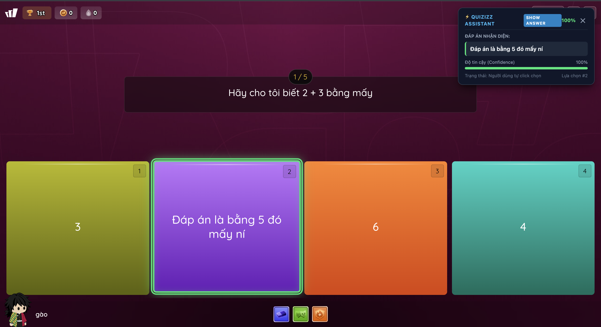
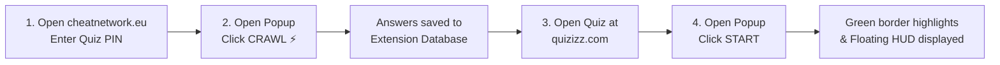

# ⚡ Quizizz Assistant - Chrome Extension (Manifest V3)

<p align="center">
  <b>Language / Ngôn ngữ:</b>
  <a href="README.md">🇻🇳 Tiếng Việt</a> |
  <b><a href="README.en.md">🇬🇧 English</a></b>
</p>

> **Smart and Safe Quizizz Companion**: Automatically extracts question & answer banks from CheatNetwork, identifies active questions in real time, and highlights correct answers (**Show Answer**) directly on the Quizizz interface.

---

## 📋 Table of Contents
1. [Key Features](#-key-features)
2. [Project Structure](#-project-structure)
3. [Prerequisites](#-prerequisites)
4. [Installation & Build Guide](#-installation--build-guide)
5. [Step-by-Step: Adding to Chrome Extensions](#-step-by-step-adding-to-chrome-extensions)
6. [Detailed Workflow](#-detailed-workflow)
7. [How to Reload After Code Changes](#-how-to-reload-after-code-changes)
8. [Troubleshooting & FAQs](#-troubleshooting--faqs)
9. [Disclaimer & Best Practices](#-disclaimer--best-practices)

---

## 🚀 Key Features

- 🎯 **1-Click Answer Crawler**: Automatically scrapes and extracts all questions and answers from `cheatnetwork.eu/services/quizizz` into `chrome.storage.local`.
- 🧠 **Intelligent Fuzzy Matching & Normalizer**:
  - Automatically cleans strings, removes HTML artifacts, extra whitespace, and choice prefixes such as `A.`, `B.`, `C.`, `D.`.
  - Works accurately with both English and Vietnamese quizzes.
- 🧩 **Broad Question Type Support**:
  - **Single-choice questions**.
  - **Multiple-choice questions (Multi-select / MSQ)**: Simultaneously detects and highlights all correct options.
  - **Fill-in-the-blank questions**: Auto-fills or suggests the correct answer directly into the input field.
- 🟢 **Intuitive & 100% Safe (Show Answer Only)**:
  - **Glowing green border highlight**: Highlights correct options directly on the screen.
  - **Smart Floating HUD**: Displays detailed recognized answers, question preview, and confidence score (%) at the top corner, with collapsible mini-widget support.
  - **Undetectable & Safe**: Users click answers manually at their own natural speed, eliminating bot-detection risks or accidental early submission clicks.
- 🌐 **Bilingual UI (VIE / ENG)**: Seamlessly toggle between English and Vietnamese right from the Popup header. All UI labels, status alerts, and the in-game Floating HUD synchronize immediately.
- ⚡ **High Compatibility**: Fully supports `quizizz.com`, `wayground.com`, and `cheatnetwork.eu`.

---

## 📂 Project Structure

```text
Quizz_Tool/
├── build.js                 # esbuild bundling script
├── package.json             # NPM dependencies & scripts
├── tsconfig.json            # TypeScript configuration
├── README.md                # Vietnamese documentation
├── README.en.md             # English documentation
├── dist/                    # ⚠️ BUILD OUTPUT DIRECTORY (LOADED INTO CHROME)
│   ├── manifest.json        # Manifest V3 extension configuration
│   ├── background/          # Background Service Worker
│   ├── content/             # Content scripts (quizizz.js & crawler.js)
│   └── popup/               # Popup UI (HTML, CSS, JS)
└── src/                     # TypeScript Source Code
    ├── manifest.json
    ├── background/          # Background service worker
    ├── content/             # DOM Observer, Quiz Reader & Crawler
    ├── modes/               # Answer presentation logic (show-answer.ts)
    ├── popup/               # Popup UI & controllers (VIE/ENG switcher)
    └── shared/              # i18n system, fuzzy matcher, storage & types
```

---

## 💻 Prerequisites

Before you start, make sure you have:
1. **Any Chromium-based Browser**: Google Chrome, Microsoft Edge, Brave, Opera, Vivaldi, etc.
2. **Node.js**: Version `18.x` or higher (LTS recommended).  
   *Check version:* `node -v` and `npm -v` in your Terminal / Command Prompt.

---

## 🛠 Installation & Build Guide

### Step 1: Open Terminal in the project directory
Navigate to the project root:
```bash
cd /path/to/Quizz_Tool
```

### Step 2: Install dependencies
```bash
npm install
```

### Step 3: Build the extension into `dist/`
Run the build script:
```bash
npm run build
```
You should see:
```text
Starting build...
Copied src/manifest.json -> dist/manifest.json
Copied src/popup/index.html -> dist/popup/index.html
Copied src/popup/popup.css -> dist/popup/popup.css

  dist/content/quizizz.js                ...
  dist/popup/popup.js                    ...
  dist/content/crawler.js                 ...
  dist/background/service-worker.js       ...

⚡ Done in 10ms
Build completed successfully!
```
> [!IMPORTANT]
> The runnable extension code is compiled into the **`dist/`** directory. When adding the extension to Chrome, you must select this **`dist`** directory.

---

## 🧩 Step-by-Step: Adding to Chrome Extensions

Follow these steps to load the unpacked extension into Google Chrome:

### 1. Open the Extensions management page
You can access it in either way:
- **Option 1 (Fastest)**: Type `chrome://extensions/` into your browser address bar and press **Enter**.
- **Option 2**: Click the **three dots ⋮** in the top right corner > select **Extensions** > select **Manage Extensions**.

---

### 2. Enable "Developer mode"
- In the top right corner of `chrome://extensions/`.
- Toggle the **Developer mode** switch to **ON**.

```text
[ Developer mode ] ──▶ [ ON  ⚪─● ]
```

---

### 3. Click "Load unpacked"
- Once Developer mode is enabled, three buttons appear in the top-left toolbar:
  - **Load unpacked**
  - **Pack extension**
  - **Update**
- Click **Load unpacked**.

---

### 4. Select the `dist` directory
- In the file browser dialog that appears:
  - Navigate to your project directory: `.../Quizz_Tool/`
  - Select the **`dist`** folder.
  - Click **Select** / **Open**.

> [!CAUTION]
> **Do NOT select the root project folder or `src/`!**  
> You **MUST** select the **`dist`** folder (which contains the compiled `manifest.json`).

Once loaded, **Quizizz Assistant** will appear in your extension list with its version and permissions.

---

### 5. Pin the Extension to the Toolbar
For quick access while taking a quiz:
1. Click the **Puzzle icon (🧩)** in the top right toolbar.
2. Find **Quizizz Assistant**.
3. Click the **Pin icon (📌)** to keep it visible on your toolbar.

---

## 📖 Sample image

<p align="center">
  
</p>
<br>


## 📖 Detailed Workflow



### Step 1: Extract answers from CheatNetwork
1. Go to: `https://cheatnetwork.eu/services/quizizz`
2. Enter the Quizizz game PIN or test URL so CheatNetwork loads all questions and answers.
3. Click the **Quizizz Assistant** icon on your browser toolbar to open the popup.
4. *(Optional)* Click **VIE / ENG** on the header to choose your preferred language.
5. Click **⚡ CRAWL**:
   - The extension will automatically scan and store all questions and answers.
   - Upon completion, **Status** will change to `Completed` and **Questions** will show the total count (e.g., `25`).
   - If starting a different quiz later, you can click **🗑 RESET** to clear old data.

### Step 2: Activate answer helper on Quizizz
1. Open your quiz tab: `https://quizizz.com/join` (or `https://wayground.com/join`).
2. Open the **Quizizz Assistant** popup:
   - Under **SHOW ANSWER CONTROLS**, click **START**.
   - The session status will turn to `Running`.
3. Proceed with the quiz normally:
   - As each question renders on the screen, the assistant matches it against the database.
   - **Correct answer options** are immediately highlighted with a luminous green border.
   - **Floating HUD** in the corner displays the recognized answer and confidence percentage.
   - For fill-in-the-blank questions, the answer is displayed and suggested into the input box.
   - Click the highlighted answer manually at your own pace.
4. When done or to pause, open the popup and click **STOP**.

---

## 🔄 How to Reload After Code Changes

Whenever you modify files in `src/`:

1. **Rebuild the source code**:
   ```bash
   npm run build
   ```
   *Tip: For automatic rebuilding on file save, run:*
   ```bash
   npm run watch
   ```

2. **Reload in Chrome**:
   - Open `chrome://extensions/`.
   - Find **Quizizz Assistant**.
   - Click the **Reload icon (🔄)**.
   - Refresh (**F5**) your Quizizz and CheatNetwork tabs to apply the newest content scripts.

---

## ❓ Troubleshooting & FAQs

### 1. `Manifest file is missing or unreadable` error when clicking Load unpacked?
- **Cause**: You selected the root `Quizz_Tool/` or `src/` folder, or haven't run `npm run build` yet.
- **Solution**: Run `npm run build` in the terminal, then select the **`dist`** folder when loading unpacked.

### 2. `CRAWL` button shows "Please open the cheatnetwork.eu tab..."?
- **Solution**: Make sure `cheatnetwork.eu/services/quizizz` is open in the same browser window and has finished loading questions. Refresh that tab (**F5**) and try clicking Crawl again.

### 3. Answers are not highlighted on Quizizz?
- **Checklist**:
  - Did you click **⚡ CRAWL** beforehand? (Verify that *Questions* in the popup is > 0).
  - Did you click **START** in the popup?
  - Try reloading (**F5**) the Quizizz page and click **START** again.

### 4. `Extension context invalidated` error in console?
- **Cause**: Occurs when the extension is reloaded in `chrome://extensions/` while a webpage tab was already opened.
- **Solution**: Simply press **F5 (Reload)** on your Quizizz / CheatNetwork tabs to re-establish the connection.

---

## ⚠️ Disclaimer & Best Practices

- This project is developed strictly for **educational and technical research** purposes: studying **Chrome Extension Manifest V3**, fuzzy string matching algorithms, and client-side DOM automation.
- Users are solely responsible for compliance with academic integrity guidelines and platform terms of service.

---

**Happy learning and coding!** 🎉
