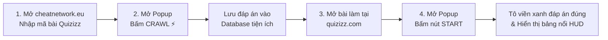

# ⚡ Quizizz Assistant - Chrome Extension (Manifest V3)

<p align="center">
  <b>Ngôn ngữ / Language:</b>
  <b><a href="README.md">🇻🇳 Tiếng Việt</a></b> |
  <a href="README.en.md">🇬🇧 English</a>
</p>

> **Công cụ hỗ trợ giải đố Quizizz thông minh và an toàn**: Tự động trích xuất ngân hàng câu hỏi & đáp án từ CheatNetwork, nhận diện câu hỏi theo thời gian thực và làm nổi bật đáp án chính xác (**Show Answer**) trực tiếp trên giao diện Quizizz.

---

## 📋 Mục lục
1. [Tính năng nổi bật](#-tính-năng-nổi-bật)
2. [Cấu trúc thư mục dự án](#-cấu-trúc-thư-mục-dự-án)
3. [Yêu cầu hệ thống](#-yêu-cầu-hệ-thống)
4. [Hướng dẫn cài đặt & Build mã nguồn](#-hướng-dẫn-cài-đặt--build-mã-nguồn)
5. [Hướng dẫn chi tiết thêm vào Chrome Extension](#-hướng-dẫn-chi-tiết-thêm-vào-chrome-extension)
6. [Quy trình sử dụng chi tiết (Workflow)](#-quy-trình-sử-dụng-chi-tiết-workflow)
7. [Cách cập nhật tiện ích khi thay đổi code](#-cách-cập-nhật-tiện-ích-khi-thay-đổi-code)
8. [Khắc phục sự cố thường gặp (Troubleshooting)](#-khắc-phục-sự-cố-thường-gặp-troubleshooting)
9. [Lưu ý an toàn & Miễn trừ trách nhiệm](#-lưu-ý-an-toàn--miễn-trừ-trách-nhiệm)

---

## 🚀 Tính năng nổi bật

- 🎯 **Cào đáp án một chạm (1-Click Crawl)**: Tự động quét và trích xuất toàn bộ câu hỏi kèm đáp án từ trang `cheatnetwork.eu/services/quizizz` lưu vào bộ nhớ cục bộ `chrome.storage.local`.
- 🧠 **Thuật toán đối sánh mờ thông minh (Fuzzy Matching & Normalizer)**:
  - Tự động chuẩn hóa câu chữ, lọc bỏ ký tự đặc biệt, HTML rác, khoảng trắng thừa và các tiền tố dạng `A.`, `B.`, `C.`, `D.`.
  - Nhận diện tốt cả đề thi tiếng Việt và tiếng Anh.
- 🧩 **Hỗ trợ đa dạng loại câu hỏi**:
  - **Trắc nghiệm 1 đáp án (Single-choice)**.
  - **Trắc nghiệm nhiều đáp án (Multi-select / MSQ)**: Nhận diện và làm nổi bật đồng thời tất cả các đáp án đúng cần chọn.
  - **Câu hỏi điền từ (Fill-in-the-blank)**: Tự động hiển thị đáp án gợi ý cho ô nhập liệu.
- 🟢 **Chế độ hiển thị trực quan & An toàn 100% (Show Answer Only)**:
  - **Highlight viền xanh phát sáng**: Tự động đánh dấu nổi bật các ô đáp án đúng trên màn hình câu hỏi.
  - **Bảng nổi thông minh (Floating HUD)**: Hiển thị đáp án chi tiết và tỷ lệ khớp (%) ngay góc màn hình, có thể thu gọn hoặc mở rộng linh hoạt.
  - **An toàn tuyệt đối**: Người dùng tự chủ động thao tác nhấp chuột theo tốc độ tự nhiên, không lo bị hệ thống phát hiện hành vi bot hay ấn nhầm nút nộp bài sớm.
- 🌐 **Hỗ trợ đa ngôn ngữ (Bilingual: VIE / ENG)**: Chuyển đổi linh hoạt giữa Tiếng Việt và Tiếng Anh trực tiếp trên thanh Header của Popup. Tất cả giao diện, thông báo lỗi/thành công và Bảng nổi HUD trên Quizizz đều được bản địa hóa và đồng bộ ngay lập tức.
- ⚡ **Tương thích cao**: Hoạt động mượt mà trên `quizizz.com`, `wayground.com` và `cheatnetwork.eu`.

---

## 📂 Cấu trúc thư mục dự án

```text
Quizz_Tool/
├── build.js                 # Script build đóng gói dự án bằng esbuild
├── package.json             # Khai báo dependencies & build scripts
├── tsconfig.json            # Cấu hình TypeScript
├── dist/                    # ⚠️ THƯ MỤC BUILD ĐƯỢC LOAD VÀO CHROME EXTENSION
│   ├── manifest.json        # Manifest V3 cấu hình Extension
│   ├── background/          # Service Worker chạy ngầm
│   ├── content/             # Content scripts (quizizz.js & crawler.js)
│   └── popup/               # Giao diện Popup Extension (HTML, CSS, JS)
└── src/                     # Toàn bộ mã nguồn TypeScript
    ├── manifest.json
    ├── background/          # Background service worker
    ├── content/             # DOM Observer, Reader & Crawler
    ├── modes/               # Logic hiển thị đáp án (show-answer.ts)
    ├── popup/               # Giao diện điều khiển Popup (hỗ trợ chuyển đổi VIE/ENG)
    └── shared/              # Hệ thống đa ngôn ngữ (i18n), thuật toán so khớp, lưu trữ và types
```

---

## 💻 Yêu cầu hệ thống

Trước khi bắt đầu, máy tính của bạn cần có:
1. **Trình duyệt web nhân Chromium**: Google Chrome, Microsoft Edge, Brave, Cốc Cốc, Opera,...
2. **Node.js**: Phiên bản `18.x` trở lên (Khuyên dùng bản LTS).  
   *Kiểm tra bằng lệnh:* `node -v` và `npm -v` trong Terminal / Command Prompt.

---

## 🛠 Hướng dẫn cài đặt & Build mã nguồn

### Bước 1: Mở Terminal tại thư mục dự án
Điều hướng đến thư mục dự án:
```bash
cd /path/to/Quizz_Tool
```

### Bước 2: Cài đặt các thư viện cần thiết (Dependencies)
```bash
npm install
```

### Bước 3: Build mã nguồn ra thư mục `dist`
Chạy lệnh đóng gói:
```bash
npm run build
```
Sau khi chạy, bạn sẽ thấy thông báo:
```text
Starting build...
Copied src/manifest.json -> dist/manifest.json
Copied src/popup/index.html -> dist/popup/index.html
Copied src/popup/popup.css -> dist/popup/popup.css

  dist/content/quizizz.js                ...
  dist/popup/popup.js                    ...
  dist/content/crawler.js                 ...
  dist/background/service-worker.js       ...

⚡ Done in 11ms
Build completed successfully!
```
> [!IMPORTANT]
> Toàn bộ file thực thi của Extension sau khi build sẽ nằm trong thư mục **`dist/`**. Khi thêm vào Chrome, bạn sẽ chọn thư mục **`dist`** này.

---

## 🧩 Hướng dẫn chi tiết thêm vào Chrome Extension

Hãy làm theo từng bước sau để nạp Extension vào Google Chrome:

### 1. Mở trang quản trị tiện ích của Chrome
Bạn có thể mở theo một trong hai cách:
- **Cách 1 (Nhanh nhất)**: Nhập vào thanh địa chỉ URL: `chrome://extensions/` rồi nhấn **Enter**.
- **Cách 2**: Nhấp vào biểu tượng **dấu 3 chấm ⋮** ở góc trên cùng bên phải trình duyệt > Chọn **Tiện ích mở rộng (Extensions)** > Chọn **Quản lý tiện ích mở rộng (Manage extensions)**.

---

### 2. Bật chế độ "Dành cho nhà phát triển" (Developer mode)
- Nhìn lên góc trên bên phải màn hình `chrome://extensions/`.
- Gạt công tắc **Chế độ dành cho nhà phát triển** (**Developer mode**) sang trạng thái **BẬT (ON)**.

```text
[ Developer mode ] ──▶ [ BẬT / ON  ⚪─● ]
```

---

### 3. Tải tiện ích đã giải nén (Load unpacked)
- Khi chế độ nhà phát triển đã bật, thanh công cụ bên trái trên cùng sẽ hiện thêm các nút hành động:
  - **Tải tiện ích đã giải nén (Load unpacked)**
  - **Đóng gói tiện ích (Pack extension)**
  - **Cập nhật (Update)**
- Bấm vào nút **Tải tiện ích đã giải nén** (**Load unpacked**).

---

### 4. Chọn thư mục `dist` của dự án
- Trong cửa sổ File Explorer / Finder hiện ra:
  - Tìm và trỏ tới thư mục dự án của bạn: `.../Quizz_Tool/`
  - Nhấp đúp vào thư mục **`dist`** (hoặc chọn thư mục **`dist`**).
  - Nhấp nút **Select** (hoặc **Open** / **Chọn thư mục**).

> [!CAUTION]
> **Rất nhiều bạn chọn nhầm thư mục gốc `Quizz_Tool/` hoặc thư mục `src/`**.  
> Bạn **BẮT BUỘC** phải chọn thư mục **`dist`** (thư mục con chứa file `manifest.json` đã build).

Sau khi nạp thành công, tiện ích **Quizizz Assistant** sẽ hiển thị trong danh sách tiện ích của bạn với phiên bản và các quyền tương ứng.

---

### 5. Ghim tiện ích ra thanh công cụ (Pin Extension)
Để thao tác tiện lợi nhất khi làm bài:
1. Nhấp vào biểu tượng **Mảnh ghép Puzzle (🧩)** ở góc trên bên phải trình duyệt.
2. Tìm tiện ích **Quizizz Assistant**.
3. Bấm vào biểu tượng chiếc **Ghim (📌)** để biểu tượng tiện ích luôn xuất hiện cố định trên thanh công cụ.

---

## 📖 Quy trình sử dụng chi tiết (Workflow)



### Bước 1: Trích xuất ngân hàng đáp án từ CheatNetwork
1. Mở trang: `https://cheatnetwork.eu/services/quizizz`
2. Nhập mã PIN của bài Quizizz hoặc link bài làm để trang CheatNetwork tải toàn bộ danh sách câu hỏi và đáp án.
3. Nhấp vào biểu tượng **Quizizz Assistant** trên thanh công cụ trình duyệt để mở popup.
4. Bấm nút **⚡ CRAWL**:
   - Tiện ích sẽ tự động quét toàn bộ câu hỏi và đáp án hiển thị trên trang.
   - Khi hoàn tất, mục **Status** chuyển sang `Completed` và mục **Questions** sẽ hiển thị tổng số câu hỏi đã lưu (Ví dụ: `25`).
   - Nếu bạn muốn làm bài mới khác, có thể bấm nút **🗑 RESET** để dọn sạch dữ liệu cũ.

### Bước 2: Kích hoạt hỗ trợ hiển thị đáp án trên Quizizz
1. Mở tab làm bài thi: `https://quizizz.com/join` (hoặc `https://wayground.com/join`).
2. Mở Popup **Quizizz Assistant**:
   - Tại mục **SHOW ANSWER CONTROLS**, nhấn nút **START**.
   - Trạng thái phiên sẽ chuyển sang `Running`.
3. Vào làm bài thi bình thường:
   - Khi từng câu hỏi xuất hiện trên màn hình, tiện ích sẽ tự động đối chiếu nội dung với cơ sở dữ liệu đã cào.
   - **Ô đáp án đúng** sẽ lập tức được tô viền màu xanh lá phát sáng nổi bật (hỗ trợ cả câu hỏi chọn 1 hoặc nhiều đáp án).
   - **Bảng nổi HUD** ở góc màn hình sẽ hiển thị chi tiết câu hỏi, đáp án gợi ý và độ tương đồng.
   - Với dạng câu hỏi điền từ (fill-in-the-blank), đáp án đúng sẽ được hiển thị trên HUD hoặc tự động gợi ý vào khung nhập.
   - Bạn chỉ cần tự tay nhấp chuột vào đáp án đã được đánh dấu theo nhịp độ tự nhiên của mình.
4. Khi làm xong hoặc muốn tạm dừng, mở popup và nhấn **STOP**.

---

## 🔄 Cách cập nhật tiện ích khi thay đổi code

Khi bạn chỉnh sửa mã nguồn trong thư mục `src/`:

1. **Re-build mã nguồn**:
   ```bash
   npm run build
   ```
   *Mẹo: Nếu đang phát triển, hãy chạy:*
   ```bash
   npm run watch
   ```
   *(Lệnh này sẽ tự động build lại mỗi khi bạn nhấn Ctrl+S lưu file).*

2. **Tải lại trên trình duyệt**:
   - Vào `chrome://extensions/`.
   - Tìm thẻ **Quizizz Assistant**.
   - Bấm vào biểu tượng **Vòng xoay Reload (🔄)**.
   - Quay lại tab Quizizz và CheatNetwork, bấm **F5 (Reload)** trang để áp dụng script mới nhất.

---

## ❓ Khắc phục sự cố thường gặp (Troubleshooting)

### 1. Báo lỗi `Manifest file is missing or unreadable` khi Load unpacked?
- **Nguyên nhân**: Chọn nhầm thư mục gốc `Quizz_Tool/` hoặc thư mục `src/`, hoặc chưa chạy lệnh `npm run build`.
- **Cách xử lý**:
  1. Mở terminal chạy `npm run build`.
  2. Đảm bảo thư mục `dist/manifest.json` đã xuất hiện.
  3. Chọn chính xác thư mục **`dist`** khi bấm "Load unpacked".

### 2. Bấm nút `CRAWL` báo "Vui lòng mở tab trang web cheatnetwork.eu..."?
- **Cách xử lý**: Đảm bảo bạn đã mở tab `cheatnetwork.eu/services/quizizz` trên cùng một cửa sổ trình duyệt và trang đã tải xong danh sách câu hỏi. Sau đó thử bấm **F5** tab CheatNetwork rồi bấm nút Crawl lại.

### 3. Tiện ích không tô màu đáp án trên Quizizz?
- **Kiểm tra**:
  - Bạn đã bấm nút **⚡ CRAWL** trước đó chưa? (Kiểm tra xem *Questions* trong popup có > 0 không).
  - Bạn đã bấm nút **START** trong popup chưa?
  - Thử tải lại trang Quizizz (F5) rồi bấm **START** lại.

### 4. Lỗi `Extension context invalidated` trong console?
- **Nguyên nhân**: Thường xuất hiện khi bạn vừa nạp lại (Reload) Extension trong `chrome://extensions/` trong khi tab Quizizz/CheatNetwork vẫn đang mở từ phiên trước.
- **Cách xử lý**: Đơn giản chỉ cần **F5 (Reload)** lại các tab Quizizz và CheatNetwork đang mở là mọi thứ sẽ kết nối lại bình thường.

---

## ⚠️ Lưu ý an toàn & Miễn trừ trách nhiệm

- Ứng dụng được phát triển với mục đích **nghiên cứu kỹ thuật**, thử nghiệm lập trình **Chrome Extension Manifest V3**, thuật toán so khớp chuỗi (Fuzzy Matching) và xử lý tương tác DOM.
- Người dùng tự chịu trách nhiệm về mục đích và quy chuẩn liêm chính học thuật khi sử dụng công cụ này trên các nền tảng thi cử.

---

**Chúc bạn cài đặt thành công và sử dụng hiệu quả!** 🎉
